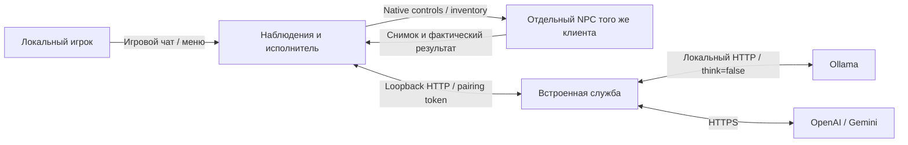

# Архитектура 0.7

## Изоляция NPC

NPC — отдельный стандартный сетевой Player prefab с маркером в ZDO и компонентом CompanionNpc. Это позволяет сохранить обычную физику, внешний вид, экипировку, пищу и навыки. NPC никогда не вызывает SetLocalPlayer и не подменяет Player.m_localPlayer. PlayerController NPC выключен, PlayerController человека остаётся игровым.

У обычного принадлежащего клиенту Player.FixedUpdate есть удаление нелокального персонажа, а Player.Update читает глобальный ввод. Harmony заменяет эти два цикла **только для помеченного NPC**. Физика/оружие/анимация Character и Humanoid продолжают работать. Собственный тик вызывает выбранные per-player обновления очереди действий, оружия, приседания/уклонения, укрытия, пищи, выносливости, эйтра и скрытности. Исключены локальные клавиши, камера, автоподбор, глобальный профиль, интерфейс инвентаря и штатное возрождение человека.

NPC-контроллер разрешён только хосту, при сетевом владении и для отдельного живого NPC. Владение помеченным ZDO закрепляется за хостом. Чужие игроки/объекты этой политикой не изменяются. Применение ввода проверяет, что actor не равен локальному человеку. Смена мира/потеря объекта/службы останавливает AI. F9 очищает мотор и фоновые запросы, не снимая ручное управление человека.

Профиль NPC хранится native Player.Save package в его постоянном ZDO. Изменения инвентаря и сохранение мира обновляют пакет; дубль проверяется по всей базе ZDO, а не только загруженным объектам. Смерть использует отдельное надгробие и ID NPC без Game.GetPlayerProfile/RequestRespawn. В ограниченной NPC-области подавлены всплывающие открытия/вспышки HUD и статистика человека. Порталы/камерные действия NPC запрещены.

## План и мотор

Снимок включает 64 предмета личного инвентаря, до 128 сущностей, 80 ближайших загруженных выпавших стопок до 128 м, лидера/игроков до 60 м, врагов/ресурсы/станции поблизости, 24 рецепта, эффекты и погоду. Содержимое контейнера появляется только после NPC-проверки доступа. supported_actions объявляет фактически доступный набор: 38 действий NPC, дополнительно ограниченных выключением боя.

Python-планировщик генерирует план фоново. Облачные модели возвращают до 6 шагов, локальные — до 3. Игровые снимки не ждут генерацию. Один шаг выдаётся с plan_id и арендой максимум 3 секунды; мод продлевает его свежими наблюдениями, сохраняя маршрут/резерв/натяжение лука. success/blocked продвигают план, провал предпосылки отменяет зависимые шаги. Непрерывное follow не заканчивается по таймеру; подбор/доставка имеют ограниченный бюджет. Отсутствие свежего lease останавливает ввод.

Мотор использует штатные пути и управление, повторы поиска и проверку прогресса. Координаты/скорость NPC не переписываются каждый кадр. NPC не приостанавливается из-за набора человеком сообщения или открытого инвентаря; настоящая пауза одиночной игры естественно останавливает физику. Срочная защита и питание выполняются между ответами при включённых разрешениях.

TransferPolicy выбирает резерв exact/all_matching/all_inventory из наблюдаемых ID. TransferBatch проверяет все остатки перед мутацией, повторно проверяет получателя, измеряет фактическое уменьшение и не допускает второго commit. Квестовые предметы защищены. Частичный результат передаётся как action_completed_amount; исходная выдача после него автоматически не повторяется.

Сундуки имеют отдельную NPC-сессию без InventoryGui. Крафт/ремонт используют нативные проверки станции и методы инвентаря с расходованием ресурсов. Неподдержанные особые рецепты возвращают причину. Строительство/ремонт строений/самостоятельный сон не выдаются модели в этой версии.

## Чат, модели и интерфейс

Одна точная фраза «следуй за мной» обрабатывается без модели. Остальные формулировки поручений интерпретирует AI. Сетевой отправитель проверяется по владельцу ZDO, NPC и собственные ответы исключаются. Имя явно адресует NPC; обычные реплики разбираются по контексту. Новое явное поручение заменяет старые ожидающие обращения; дубль не отменяет уже идущую генерацию. Ревизия/сессия/эпоха выполнения исключают старые планы после команды или реального изменения инвентаря.

Встроенная Windows-служба запускается автоматически на случайном loopback-порту с отдельным pairing token. API-ключи остаются в памяти, Ollama использует локальный HTTP без ключа. think=false применяется к планам, чату и проверке; смена локальной модели сериализована и сначала выгружает остальные запущенные модели. Облачный бюджет с повторами — 100 с, транспорт мода — 110; локальная генерация — до 300 с, UI — 310 с. Облачный 503 имеет ограниченные повторы с паузами 2/4 с и охлаждением 15 с.

Esc/F8 открывает окно на штатном масштабе Valheim с вкладками «Персонаж», «Подключение AI», «Журнал». Наблюдения и отладка общие с дополнительным веб-интерфейсом; браузер не требуется. Журнал маскирует ключи; «Диалог AI» показывает сохранённые request/raw response/validation, имеет страницы и экспорт. История ограничена памятью и не запрашивает модель заново.

Ссылочный SDK открывает некоторые защищённые методы: NativeMethods вызывает их reflection, чтобы не получить MethodAccessException на настоящей игре. PE-проверка запрещает прямую ссылку на GetRightItem. Игровые/Unity/BepInEx DLL в релиз не входят. Совместимость с Valheim 1.0.21 требует игрового теста; cloud CI не запускает игру.
