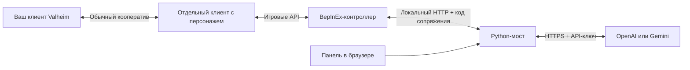

# Устройство прототипа



Мод не создаёт второго `Player` внутри одного процесса: такая сущность не получает штатную сессию игрока и требует отдельной системы сохранений, смерти и репликации. Здесь используется существующий `Player.m_localPlayer` второго клиента. Игра сама ведёт его профиль и сетевую сессию. Логин Steam, подключение к миру и возрождение не автоматизируются.

## Цикл

1. Человек включает контроллер через F8. До этого мод ничего не делает с персонажем.
2. Штатный `PlayerController` остаётся включённым. Harmony-перехват `Player.SetControls` заменяет только ввод локального персонажа напарника, если клиент владеет его сетевым объектом. Другие игроки и сетевые компоненты не изменяются.
3. Снимок включает собственное состояние, до 64 предметов инвентаря, одного выбранного лидера, до 16 агрессивных врагов и до 32 предметов на земле. Враги/предметы ограничены 20 м, лидер — 60 м. Выбираются только монстры, уже целящиеся в напарника или лидера.
4. В локальном режиме мост возвращает `follow`/`wait` без внешних запросов. В AI-режиме он вызывает выбранного провайдера со схемой JSON. Никакого исполнения сгенерированного кода нет.
5. Мост проверяет схему и существование цели, мод повторяет проверку версии, номера снимка, типа цели, дистанции и разрешения боя. Во время исполнения мод снова проверяет актуальность объектов и состояние игрока.
6. Команда живёт не более 3 секунд реального времени. До следующего ответа нажатия очищены. F9 отменяет HTTP-запрос и снимает подмену ввода.

Маршрут выбирается через встроенный `Pathfinding.GetPath` с `HumanoidNoSwim`. Горизонтальное ограниченное направление передаётся штатному `SetControls` как ввод вперёд относительно направления взгляда; `SetMoveDir` напрямую не вызывается. Прямой записи координат нет. Атака подаётся через `SetControls`; урон, прочность и стоимость атаки остаются штатными. Предметы используются через `Humanoid.UseItem`, подбор — через `Humanoid.Pickup`. Здоровье и выносливость мод не пополняет и вещи не создаёт.

Это архитектурное ограничение механик, а не доказательство идеального поведения. Ошибки навигации, анимации, ограничения модов и изменения API требуют игровой проверки. Для дальнего боя, строительства и ресурсов пока нет исполнителей.

## HTTP v1

`GET /health` открыт для проверки процесса. Все `/api/*` требуют `Authorization: Bearer <bridge-token>`. Обслуживается один персонаж; свежая сессия другого персонажа отклоняется в течение 30 секунд после последнего снимка. Повторное включение того же персонажа разрешено, но сбрасывает режим на «стоп».

| Маршрут | Назначение |
| --- | --- |
| `GET /api/status` | Состояние подключения, провайдер, журнал без ключей |
| `POST /api/provider` | `provider`, `model`, необязательный `api_key`; ключ только в памяти |
| `POST /api/models/gemini` | Список моделей с поддержкой generateContent |
| `POST /api/check/gemini` | Карточка модели, простая генерация и формат действий; ответ Google после удаления ключей |
| `POST /api/command` | `mode`: `stop`, `follow`, `ai`; `objective` |
| `POST /api/decision` | Наблюдение `Snapshot`; ответ с одним ограниченным действием |

Снимок имеет `protocol_version=1`, случайный `session_id`, возрастающий `sequence`, `actor`, `entities`, `leader_id`, `previous_result`. Каноническая схема: `bridge/src/valheim_ai/protocol.py`. Сериализуемые поля Unity: `mod/ValheimAIHelper/Protocol.cs`.

Пример ответа:

```json
{
  "protocol_version": 1,
  "sequence": 42,
  "action": "follow",
  "target_id": "character:721",
  "duration": 3,
  "say": "Следую за лидером",
  "source": "openai",
  "command_revision": 3
}
```

Допустимы только `wait`, `follow`, `move`, `attack`, `pickup`, `eat`, `equip`. `target_id` берётся из данного снимка; для `wait` и `move` он пуст. `move` означает до 4 м вперёд по направлению персонажа, с теми же ограничениями пешей навигации и времени. Снимок 0.1.1 содержит `actor.forward` и `supported_actions`; старым клиентам без объявления этой возможности `move` не разрешается. Номера объектов локальны для клиента; предметы инвентаря дополнительно сопоставляются по ссылке на исходный объект, чтобы замена содержимого ячейки не меняла смысл отложенного ответа.

Версия 0.1.1 использует общий C#-сериализатор `WireJson` на `DataContractJsonSerializer`. Проверка `scripts/check_wire.py` передаёт его реальный JSON в Python HTTP API, затем читает ответы `follow` и подставной модели `move` тем же C#-декодером и политикой. Отрицательные остатки здоровья/выносливости отображаются как ноль; пустые стеки исключаются из наблюдения. Значения в самой игре не меняются. Некорректные координаты и неизвестные действия по-прежнему отклоняются.

Ошибки схемы отображаются в статусе и журнале панели и в моде как HTTP 422 с безопасным путём поля. В ответы не включаются исходные значения, тела запросов и неизвестные имена полей. До первого корректного наблюдения и при ошибке последнего снимка команды не принимаются; «Стоп» доступен всегда.

При смене команды/провайдера или появлении более свежего снимка ответ выполняющегося запроса заменяется на `wait`. Одновременно выполняется максимум один запрос к модели; очередь устаревших решений не накапливается. Ошибки API не выдаются за успех: в журнале показываются понятная причина и `fallback`.

## Ключи и данные

Ключ передаётся только на фиксированный HTTPS-адрес выбранного API: `api.openai.com` либо `generativelanguage.googleapis.com`. Он не попадает в URL, ответы панели или мод. Тела ошибок провайдера не показываются. Даже ошибки валидации входных параметров исключают исходные значения, которые могли содержать ключ.

Мост слушает только `127.0.0.1`; проверяются Host, Origin и код сопряжения. Межсайтовые запросы запрещены, внешних скриптов интерфейса нет. Вкладка хранит код сопряжения в памяти, не в URL или localStorage. Файл `bridge-token` — локальный пароль управления; он и Python-окружение исключены из Git и архива.

Следующие разумные этапы после игровой проверки: длительные цели и планировщик, восстановление после застревания, защита щитом, взаимодействие с контейнерами и рецепты крафта через существующие игровые проверки. Полноценный автономный игрок и одно-клиентный NPC требуют отдельной разработки.

Для AI действует настраиваемый интервал между решениями (по умолчанию 20 секунд), независимый от локального следования. HTTP 404/429 останавливает AI до действий оператора. 503 повторяется с паузами в рамках общего лимита ожидания. Явная диагностика Gemini использует два запроса генерации, без данных реального персонажа.
