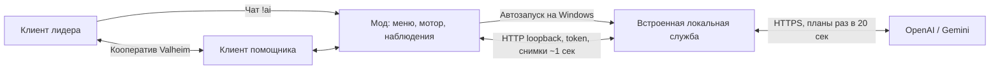

# Архитектура 0.3

Обычный `Player.m_localPlayer` живёт во втором клиенте игры. Логин, сетевое подключение, профиль, здоровье, урон, сохранения и возрождение остаются игровыми. Мод не создаёт NPC и не заменяет сетевой транспорт.

## Управление и планы

`PlayerController` остаётся включён. Harmony-перехват `Player.SetControls` подменяет только ввод локального персонажа, которым владеет этот клиент. Движение в мире преобразуется в ввод относительно взгляда, прицеливание независимо от направления движения. Атаки/лук/блок/прыжок/уклонение используют обычный игровой ввод, а еда, экипировка, подбор и взаимодействие — игровые методы с их проверками.

Снимок ограничен 64 предметами инвентаря, 16 враждебными монстрами, 32 выпавшими предметами и 12 растениями/дверями. Общее число сущностей не превышает 64; враги и предметы видны в радиусе 20 м, лидер — 60 м. Расширенные поля описывают цели и здоровье врагов, оружие/прочность/еду и состояние персонажа. Инвентарные ID стабильны для объекта в пределах процесса, а не номера постоянно меняющихся ячеек.

Новые клиенты объявляют `background_planning=true`. Python-планировщик вызывает API в отдельной asyncio-задаче; HTTP-снимки не ждут модель. Модель получает цель, снимок и историю реальных результатов и возвращает до 6 шагов. `supported_actions` не позволяет старому клиенту получить неизвестное действие.

Служба выдаёт одно действие с `plan_id` и арендой максимум на 3 секунды. Каждую секунду мод отправляет новый снимок и продлевает действие. Продление сохраняет маршрут, натяжение лука и завершённые одноразовые действия. `action_status=success/blocked` вместе с тем же `plan_id` продвигает план; неудачная предпосылка отменяет хвост. Шаг ограничен 25 секундами, затем нужен новый план. Каждая цель перепроверяется по свежему снимку до выдачи и по живому игровому объекту во время исполнения.

Срочная защита себя/лидера и использование еды работают в игровом моторе между API-решениями, если включены соответствующие переключатели. В режиме стопа они не работают. При открытой панели/меню ввод приостановлен; после потери связи старый ввод истекает. F9 немедленно снимает управление и отменяет ожидающий HTTP-запрос.

Смена команды, провайдера или сессии отменяет фоновый план; поздний ответ не может восстановить старую команду. Более свежий снимок той же сессии не отменяет полезный ответ модели: он проверяется повторно. Для прежних клиентов сохранён синхронный режим API v1.

## HTTP и данные

`GET /health` — открытая проверка процесса. Все `/api/*` требуют локального кода сопряжения.

| Маршрут | Назначение |
| --- | --- |
| GET /api/status | Режим, наличие ключей, состояние планирования, события с ID |
| POST /api/provider | Провайдер, модель, ключ только в памяти, интервал API |
| POST /api/models/{provider} | Список моделей Gemini/OpenAI |
| POST /api/check/{provider} | Явная проверка выбранной модели, без данных персонажа |
| POST /api/command | stop/follow/ai и задача |
| POST /api/decision | Снимок и ответ с одним действием для локального мотора |

Схемы: `bridge/src/valheim_ai/protocol.py` и `mod/ValheimAIHelper/Protocol.cs`. Версия протокола остаётся 1, новые поля имеют значения по умолчанию. Поддерживаются wait/follow/move/jump/attack/defend/flee/dodge/pickup/interact/eat/equip/use. Координатное перемещение ограничено 30 м и перепадом 8 м; модель не задаёт произвольный код или игровые консольные команды.

Мост проверяет Host/Origin, слушает только 127.0.0.1, ограничивает тело запроса 64 КБ. Ключ провайдера передаётся только на фиксированный HTTPS API и не включается в URL. Диагностика внешнего API очищается от ключей. Ошибки валидации исключают исходные значения. 404/429 останавливает AI; 503 повторяется через 2/4 секунды с последующей паузой минимум 15 секунд. Общий бюджет API — 100 секунд, UI/мод — 110 секунд.

## Запуск, интерфейс и журнал

Windows-дистрибутив содержит DLL и замороженную PyInstaller-службу с Python-зависимостями. `BridgeRuntime` запускает её без консольного окна, на отдельном loopback-порту и с отдельным токеном. API-ключи не передаются в аргументах процесса и не пишутся в конфигурацию. Мод завершает только принадлежащий ему дочерний процесс. Служба также следит за дескриптором процесса игры, чтобы не остаться после аварийного выхода.

Нативное окно использует загруженные UGUI/TMP-компоненты, шрифты и фон настроек Valheim через отражение. Это позволяет не включать игровые DLL в архив. При несовместимости доступна резервная IMGUI-панель. Игра учитывает её как меню, блокируя управление камерой/персонажем.

Чат перехватывается после штатной проверки разрешений и фильтрации текста. Обрабатываются только сообщения с префиксом !ai/!ии от выбранного лидера: сверяется сетевой владелец ZDO и персонаж источника. Весь обычный чат не превращается в инструкции модели.

Журнал ограничен 300 строками. Собственные события мода и события моста с возрастающими ID объединяются без повторов после опросов. Перед показом/экспортом удаляются введённые ключи, код сопряжения и узнаваемые форматы секретов. Отчёт не содержит тела HTTP-запросов или полной конфигурации BepInEx.
