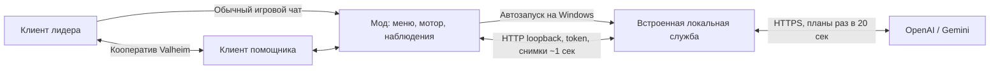

# Архитектура 0.4

Обычный `Player.m_localPlayer` живёт во втором клиенте игры. Логин, сетевое подключение, профиль, здоровье, урон, сохранения и возрождение остаются игровыми. Мод не создаёт NPC и не заменяет сетевой транспорт.

## Управление и планы

`PlayerController` остаётся включён. Harmony-перехват `Player.SetControls` подменяет только ввод локального персонажа, которым владеет этот клиент. Движение в мире преобразуется в ввод относительно взгляда, прицеливание независимо от направления движения. Атаки/лук/блок/прыжок/уклонение используют обычный игровой ввод, а еда, экипировка, подбор и взаимодействие — игровые методы с их проверками.

Снимок ограничен 64 предметами своего инвентаря, 64 предметами открытого контейнера и 64 сущностями мира. Видны враги/дикие животные, предметы, ресурсы, станции, их входы и строения. Радиус мира — 20 м, лидера — 60 м. До 24 известных рецептов и 32 деталей текущего инструмента описывают доступные ремесленные действия. Дополнительные поля показывают эффекты, вес, свободные ячейки, погоду, укрытие и комфорт. Инвентарные ID стабильны для объекта в пределах процесса.

Новые клиенты объявляют `background_planning=true`. Python-планировщик вызывает API в отдельной asyncio-задаче; HTTP-снимки не ждут модель. Модель получает цель, снимок и историю реальных результатов и возвращает до 6 шагов. `supported_actions` не позволяет старому клиенту получить неизвестное действие.

Служба выдаёт одно действие с `plan_id` и арендой максимум на 3 секунды. Мод продлевает его по свежим снимкам, сохраняя маршрут, натяжение лука и завершение одноразовых действий. `action_status=success/blocked` с тем же ID продвигает план; неудачная предпосылка отменяет хвост. Обычный шаг ограничен 25 секундами, крафт партии — до 60. Цели перепроверяются по снимку и живому игровому объекту. Политика `avoid` не разрешает атакующие шаги и меняет защитную реакцию на отступление.

Срочная защита себя/лидера и использование еды работают в игровом моторе между API-решениями, если включены соответствующие переключатели. В режиме стопа они не работают. При открытой панели/меню ввод приостановлен; после потери связи старый ввод истекает. F9 немедленно снимает управление и отменяет ожидающий HTTP-запрос.

Смена команды, провайдера или сессии отменяет фоновый план; поздний ответ не может восстановить старую команду. Более свежий снимок той же сессии не отменяет полезный ответ модели: он проверяется повторно. Для прежних клиентов сохранён синхронный режим API v1.

## HTTP и данные

`GET /health` — открытая проверка процесса. Все `/api/*` требуют локального кода сопряжения.

| Маршрут | Назначение |
| --- | --- |
| GET /api/status | Режим, наличие ключей, состояние планирования, события с ID |
| POST /api/provider | Провайдер, модель, ключ только в памяти, интервал API |
| POST /api/models/{provider} | Список моделей Gemini/OpenAI |
| POST /api/check/{provider} | Явная проверка выбранной модели, без данных персонажа |
| POST /api/command | stop/follow/ai и задача |
| POST /api/chat | Контекстное сообщение разрешённого игрока; намерение или очередь для планировщика |
| POST /api/decision | Снимок и ответ с одним действием для локального мотора |

Схемы: `bridge/src/valheim_ai/protocol.py` и `mod/ValheimAIHelper/Protocol.cs`. Версия протокола — 1, новые поля имеют значения по умолчанию. Каталог из 40 команд и механики описаны в [mechanics.md](mechanics.md). Снимок объявляет только поддерживаемые исполнителем команды; при несовместимости placement-перехвата стройка не объявляется. Координаты движения ограничены 30 м/перепадом 8 м, строительства — 8 м с последующим штатным наведением и проверками игры.

Мост проверяет Host/Origin, слушает только 127.0.0.1, ограничивает тело запроса 128 КБ. Ключ передаётся только на фиксированный HTTPS API и не включается в URL. Диагностика очищается от ключей, валидация не отражает исходные значения. 404/429 останавливает AI; 503 повторяется через 2/4 секунды с ожиданием минимум 15 секунд. Общий бюджет — 100 секунд, UI/мод — 110.

## Запуск, интерфейс и журнал

Windows-дистрибутив содержит DLL и замороженную PyInstaller-службу с Python-зависимостями. `BridgeRuntime` запускает её без консольного окна, на отдельном loopback-порту и с отдельным токеном. API-ключи не передаются в аргументах процесса и не пишутся в конфигурацию. Мод завершает только принадлежащий ему дочерний процесс. Служба также следит за дескриптором процесса игры, чтобы не остаться после аварийного выхода.

Окно создаёт собственный Canvas, кнопки и TMP-поля без обязательного старого шаблона. Шрифт берётся из Valheim, scaleFactor повторяет живой игровой Canvas; собственного CanvasScaler 1280×800 нет. Размер ограничивается штатным окном настроек и экраном. Разделы выделены полосой вкладок; дополнительные переключатели вынесены в подстраницу, ввод задачи заменён игровым чатом. Кнопка Esc ищется по полям и иерархии, с учётом GUIFramework-обёрток и отсутствия LayoutGroup; установка повторяется после загрузки. Её шрифт не растёт выше штатного, визуальные компоненты сохраняются, есть подсветка мышью/выбором. При ошибке остаётся IMGUI-резерв. Открытое окно блокирует игровой ввод.

Чат перехватывается после штатных разрешений/фильтрации: сверяется сетевой владелец ZDO и политика «Только лидер»/«Все игроки». Очередь хранит клиентские ID/владельца отдельно от передаваемого JSON; разрешение перепроверяется до/после HTTP. Смена политики вызывает стоп и отменяет очередь/разбор. Имя персонажа — явный адресат; обычные реплики проходят контекстный разбор с именами отправителей. При активном AI этот разбор совмещён с планом, вне AI возможен отдельный ограниченный запрос. Контекст — до 12 реплик, очередь — 6. Намерение содержит ID сообщения и признак адресованности; только подтверждённое обращение меняет задачу. Стоп/смена команды отменяет разбор и проверяет ревизию перед применением ответа.

Ссылочный ValheimGameLibs публично открывает некоторые непубличные методы игры. GetRightItem в настоящем Humanoid защищён: прямой вызов компилируется по пакету, но вызывает MethodAccessException при JIT наблюдения. NativeMethods вызывает его через reflection с поиском в базовых классах и сохраняет исходное исключение. Проверка PE-метаданных готовой DLL запрещает прямую ссылку на этот метод. Игровые DLL в архив не включаются.

Станции и контейнеры используют обычные интерфейсы игры. Содержимое контейнера читается после открытия, получения владения и проверки доступа; частичные переносы выполняются нативными методами инвентаря. Крафт выбирает вкладку/рецепт и кнопку, затем ждёт предмет/качество; F9 отменяет принадлежащий моду крафт и закрывает его интерфейс. Стройка подаёт ввод в полный UpdatePlacement, где игра проверяет место и списывает материалы/выносливость/прочность. Прямого спавна построек или выдачи предметов нет.

Журнал ограничен 300 строками. Собственные события мода и события моста с возрастающими ID объединяются без повторов после опросов. Перед показом/экспортом удаляются введённые ключи, код сопряжения и узнаваемые форматы секретов. Отчёт не содержит тела HTTP-запросов или полной конфигурации BepInEx.
