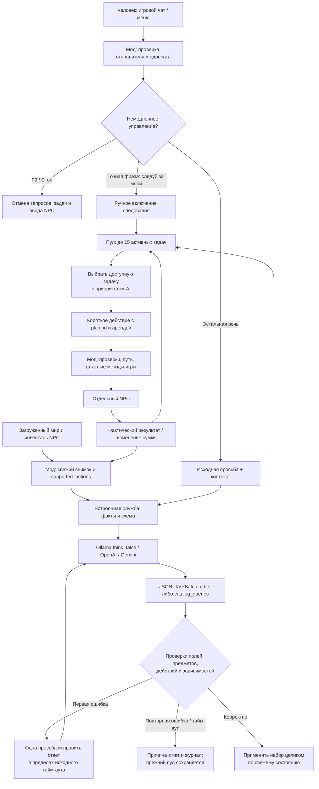

# Архитектура 0.8.4

Один клиент Valheim содержит человека и отдельного NPC. Мод наблюдает мир и исполняет игровые действия. Встроенная Python-служба хранит пул задач, обращается к выбранной модели и проверяет её ответы. AI определяет смысл поручения, цели, приоритеты и зависимости. Мод проверяет допустимость и фактический результат.

Новое обращение не останавливает прежнюю допустимую работу, пока AI готовит ответ. Смена провайдера сохраняет задачи на паузе. Обмен с NPC временно приостанавливает исполнение до закрытия окна; явная ручная пауза при этом сохраняется. F9 отменяет работу и ожидающие ответы; закрытие инвентаря и поздний ответ модели не могут отменить этот стоп.

## Граница между моделью и исполнителем

| Решение | Кто отвечает |
|---|---|
| К кому относится обычная реплика при нескольких людях | Короткий AI-классификатор с контекстом; явное имя задаёт адресата. Разрешённая речь единственного человека направляется NPC напрямую. |
| Что означает «пошли», что собирать и кому передать | AI по исходному поручению; словаря синонимов команд в моде нет. |
| Какие задачи создать, их приоритеты 0–90 и зависимости | AI. Приоритет новой задачи обязателен в ответе. |
| Есть ли предмет, доступно ли действие и корректен ли граф | Проверки Python по снимку и затем игровые проверки мода. |
| Как подойти к текущей цели, взаимодействовать и подтвердить результат | Исполнитель мода и штатные методы игры. |
| Когда продолжить постоянное следование или выбрать следующий подходящий камень | Пул задач и исполнитель по свежему наблюдению, без нового AI-ответа на каждый шаг. |
| Как продолжить произвольную цель после выполненного этапа | AI получает свежий контекст и выбирает следующие атомарные шаги. |

Срочная защита и питание, если разрешены пользователем, остаются локальными реакциями исполнителя. Они не назначают стратегические цели и не повышают автоматически приоритет следования. Если AI выбрал сбор возле лидера, ограничение радиуса определяет доступность цели, а не её важность. Пул не обещает почти человеческого понимания любой речи: способность составить подходящий план зависит от модели.

Готовность следования проверяется отдельно от приоритета: когда NPC уже в 2,5 м на той же высоте, задача ждёт движения человека и не занимает исполнителя. С 4 м или при перепаде высоты свыше 1,2 м она снова требует движения. Поэтому план `follow:90` + `collect:80` может собирать рядом и возобновлять следование за ушедшим лидером, сохраняя обе цифры AI.

## Что отправляется и что хранится

Мод передаёт по loopback HTTP состояние NPC, видимые объекты, игровые возможности и результат последнего действия. Наблюдение включает инвентарь NPC, лидера, игроков, врагов, загруженные выпавшие вещи и объекты сбора через E, станции, рецепты и доступный контейнер. Содержимое закрытых сундуков и незагруженные объекты не раскрываются. Каталог типов строится из базы установленной игры, включая зарегистрированные предметы других модов.

Запрос составления пула содержит:

- исходную просьбу `latest_request` и до шести последних строк диалога;
- здоровье, выносливость, положение и инвентарь NPC с признаками экипировки, еды/использования, брони и урона, ID человека-лидера;
- наблюдаемые сущности с игровыми ID, положением, типами предметов и результатами сбора;
- `supported_actions`, рецепты, варианты строительства и содержимое доступного открытого контейнера;
- существующие задачи как данные, свободные места пула и допустимые ID новых задач;
- названия и стабильные prefab наблюдаемых типов предметов, затем результаты дополнительного поиска, если его попросила модель.

Полный каталог не прикладывается к каждому поручению. AI может вернуть `catalog_queries` вместо задач и получить ограниченные словарные совпадения. Это справочник типов, а не доказательство наличия предмета. Допускаются до двух таких обращений к справочнику; модель после них должна составить план или объяснить невозможность.

AI возвращает `TaskBatch`: новые `tasks`, изменения `edits`, режим добавления/замены и разрешённую политику боя. Типы задач — `follow`, `collect`, `give`, `drop`, `action`, `goal`. Ответ в чат задаётся действием `speak`. Конкретные игровые действия используют ID из снимка; сбор и передача задают стабильные типы предметов. Успех генерации не является подтверждением подбора, передачи или движения.

| Данные | Где находятся |
|---|---|
| Физическое состояние, вещи, экипировка, еда и навыки NPC | Обычный пакет `Player.Save` в постоянном ZDO NPC, сохраняемый с миром. |
| Пул задач и необходимые подтверждения зависимостей | `BepInEx/config/ValheimAIHelper/task-pools/<SHA256>.json`, отдельно для мира и NPC. |
| Pairing token конкретного запуска | `BepInEx/config/ValheimAIHelper/runtime-<PID>/bridge-token`; не копируется в хранилище задач. |
| Настройки интерфейса и разрешений | `BepInEx/config/dev.valheim.aihelper.cfg`. |
| Читаемый каталог типов | `BepInEx/config/ValheimAIHelper/item-catalog.json`. |
| API-ключи, краткая история диалога, записи запросов/ответов и показатели скорости | Память службы до завершения; отчёт и диалог экспортируются по запросу пользователя с маскированием ключей. |

Встроенный запуск передаёт отдельный `--task-pool-dir`, поэтому новый PID игры не меняет постоянное хранилище задач. При разработческом запуске без этого параметра используется `--data-dir/task-pools`.

Миграция старых `runtime-*/task-pools` проверяет хеш пары мир + NPC и содержимое пула, выбирает наиболее свежий корректный файл и сохраняет старые файлы. Уже существующее стабильное сохранение не заменяется, включая пустой пул после отмены задач. Ошибки миграции видны как `task-storage`. Все восстановленные задачи удерживаются на паузе до явного продолжения; временные ID и незавершённая выдача не воспроизводятся вслепую.

## Проверки ответа и восстановление после ошибки формата

В 0.8.1 плоская схема JSON допускала сочетания, которые затем отвергала проверка Python: например сбор без типов предметов или вложенное действие в следовании. В 0.8.2 схема различает варианты задач и ограничивается действиями, которые объявила игра. Приоритет обязателен; предметы берутся из доступного словарного контекста. В 0.8.3 схема самого атомарного действия учитывает подходящие игровые цели: экипировка выбирает экипируемую вещь из сумки, атака — наблюдаемого врага. Без врагов атака не предлагается; ID человека не допускается как цель нападения. Дополнительные проверки исключают неизвестные ID, неподходящие атомарные действия, циклы и зависимости от бесконечного следования/сбора. Применение пула остаётся отдельной операцией по свежему снимку.

При ошибке ответа служба сохраняет конкретный путь и причину, например `$.tasks[0].item_prefabs`. Она может один раз попросить модель исправить свой ответ с исходной просьбой и тем же контекстом. Фаза `tasks-repair` использует оставшееся время первоначального запроса; новый полный тайм-аут не начинается. Мод не переписывает за AI приоритеты, цели или зависимости. Совершенно одинаковые изменения одного ID считаются идемпотентными; противоречивые изменения проверяются до применения пула и могут попасть в тот же единственный повтор. Несовпадение независимого разбора передачи также может потребовать исправления нового набора моделью; исправленный вариант проверяется повторно. Отдельное подтверждение всей сумки, проверки реальных вещей и количества сохраняются. Повторная ошибка оставляет прежний пул и сообщает причину.

Кнопка «Проверить подключение» выполняет отдельную техническую проверку доступности выбранной модели: короткий обычный запрос с пределом 16 выходных токенов. В Ollama проверяются локальная модель и её ответ при `think=false`, без `format` и JSON-схемы; контекст этой проверки — 1024 вместо игрового 16384. Для Gemini сначала получается карточка выбранной модели, затем выполняется короткая обычная генерация; OpenAI получает короткий запрос чата. Любой непустой ответ означает, что модель доступна, даже если текст похож на пустой игровой план. Компилятор задач, игровые наблюдения, каталог и пул в этой проверке не участвуют. Результат фиксируется в диалоге как `check` и не является оценкой качества игрового планирования. F9 отменяет ожидание. Проверка другой модели Ollama по-прежнему останавливает текущий AI перед выгрузкой прежней модели; после неё нужно сохранить подключение и включить AI.

## Изоляция NPC и игровые операции

NPC — отдельный стандартный сетевой Player prefab с маркером в ZDO и компонентом CompanionNpc. Он не вызывает SetLocalPlayer и не подменяет Player.m_localPlayer. PlayerController NPC выключен; управление человеком остаётся игровым. Harmony заменяет Player.Update/FixedUpdate только для помеченного NPC, чтобы стандартный цикл не удалял нелокального персонажа и не читал для него ввод человека. Физика, оружие и анимации Character/Humanoid продолжают работать.

Контроллер разрешён только хосту, при сетевом владении и для живого NPC. Смена мира, потеря объекта или службы останавливает управление. У NPC отдельные сохранение и надгробие, без использования профиля человека. Порталы и действия камеры NPC запрещены. Ссылочные библиотеки Valheim 0.221.4 могут открывать защищённые методы, поэтому совместимые вызовы через NativeMethods не полагаются на их публичность в настоящей игре.

Атомарное действие имеет `plan_id` и короткую возобновляемую аренду. Свежие наблюдения сохраняют маршрут и контекст уже начатой операции; истечение аренды останавливает ввод. Путь ищется штатной навигацией с проверкой реального продвижения. Переписывания координат каждый кадр и телепортации к лидеру нет.

TransferPolicy выбирает реальные стопки для `exact`, `all_matching` или `all_inventory`. TransferBatch проверяет остатки и получателя перед изменением сумки, измеряет фактическое уменьшение и не допускает повторный commit. Частичный результат передаётся как `action_completed_amount`; неопределённая выдача автоматически не повторяется. Сундуки имеют отдельную NPC-сессию; крафт и ремонт проверяют станцию и ресурсы.

Обмен человека с NPC использует его настоящий инвентарь: предпочтительно штатное окно, при недоступности адаптера — резервные две сетки. В 0.8.3 штатная панель NPC получает отдельный значок брони; резервная показывает значение в заголовке. Вызывается игровой расчёт брони NPC, учитывающий надетые вещи и эффекты; суммирования всех вещей в сумке и подмены показателя человека нет.

Открытие инвентаря вызывает временную приостановку исполнителя и передаёт `simulation_paused`. Решение, `plan_id`, итог уже начатой передачи и пул сохраняются; переподключение провайдера и постоянный HTTP-стоп для обмена не нужны. Пока окно открыто, ввод NPC заблокирован. После закрытия свежие наблюдения продолжают прежний режим. F9, смена мира/провайдера и прежняя ручная пауза остаются в силе. Совместимые уведомления окна используют необязательные параметры методов игры и запасной путь через HUD; при недоступности уведомления причина остаётся в журнале.

## Речь NPC

Ответы службы и атомарное `speak` используют `Say` RPC собственного игрового объекта NPC. Копия `UserInfo` содержит имя NPC; транспортный аккаунт и штатные проверки разрешений сохраняются. На клиенте владельца мода и других клиентах с модом принятый NPC-ответ получает его имя в журнале чата и отдельный ключ надголовной реплики. Сообщения людей не переименовываются, собственная речь NPC не возвращается в очередь поручений.

Штатный журнал клиента без мода может выбирать имя по платформенному списку игроков и показывать аккаунт хоста. Для исправленного имени NPC в журнале такого клиента ему также нужен мод; имя NPC в сетевом `UserInfo` и надголовный текст передаются.

## Служба, диагностика и проверка сборки

Windows-служба запускается модом на случайном loopback-порту и завершается с игрой. Ollama работает по локальному HTTP; все её генерации, включая проверку и исправление формата, сохраняют обязательное `think=false`. Смена модели сериализована и сначала выгружает остальные запущенные модели. Облачные обращения используют HTTPS. Для облачного 503 предусмотрены ограниченные повторы с паузами; F9 отменяет ожидание.

Ошибки Ollama сохраняют HTTP-код и ограниченное объяснение сервера. Отсутствующая модель, нехватка памяти и явный отказ параметра `think=false` различаются. Присутствия одного слова `think` в ошибке недостаточно для вывода о неподдерживаемом отключении размышлений. Автоматического включения размышлений нет.

Esc/F8 использует штатный масштаб Valheim; журнал показывает версии, NPC, пул, причины и скорость модели. «Диалог AI» хранит request, сырой response и validation для фаз `tasks`, `tasks-repair`, `catalog-lookup`, `task-transfer`, `task-scope` и `task-step`; просмотр и экспорт не вызывают модель повторно. Меню и необязательные UI-члены кэшируются без предупреждений AccessTools при каждой проверке.

CI проверяет код и протокол на Linux и Windows, на Windows собирает встроенную службу и ZIP, затем публикация в main создаёт релиз с исходниками и архивом. Результаты конкретной проверки записываются в [validation.md](validation.md). Valheim 1.0.21 здесь не запускается: движение, физику, окно инвентаря и совместимость установленного набора модов нужно проверить в игре по [сценариям](task-scheduler.md#что-проверить-в-игре).
